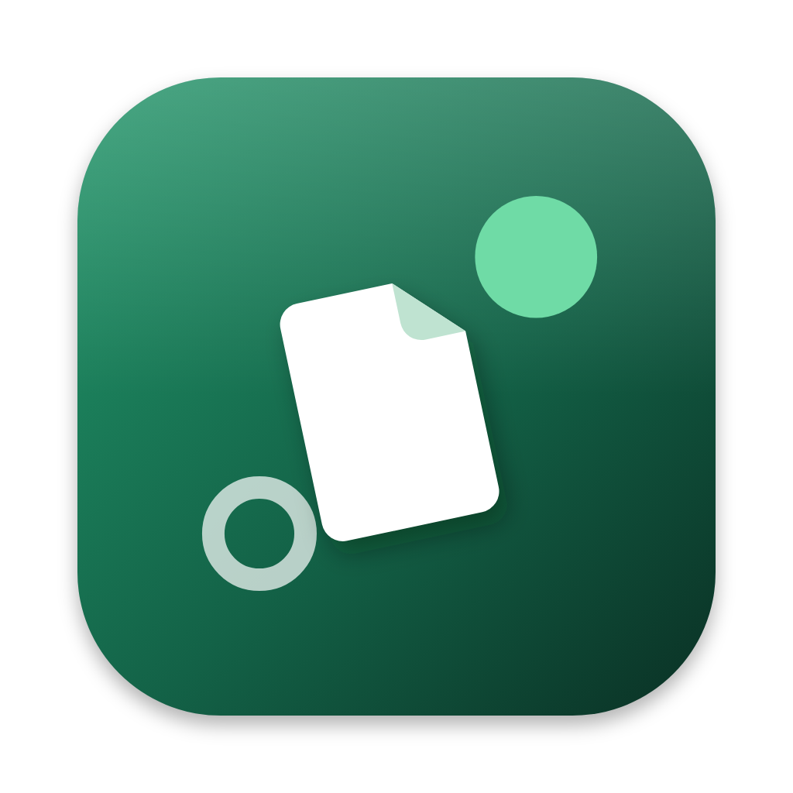

<p align="center">
  
</p>

<h1 align="center">TropicalPeer</h1>

<p align="center">Send files straight from one device to another, across the internet.<br>No accounts, no cloud, no size limits.</p>

---

TropicalPeer is a peer-to-peer file drop for **Windows, macOS and Android**. Two devices pair once with a short code like `7-orchid-tiger`. After that, either one can send files to the other, whether they're on the same Wi-Fi or on opposite sides of the world. Files travel device to device and are never stored on a server.

- **Works across networks.** Paired devices connect directly with UDP hole punching. If that fails, they fall back to an end-to-end encrypted relay.
- **Private by design.** Pairing uses a PAKE (CPace), so the server never learns the code. Transfers are encrypted over QUIC and checked with SHA-256.
- **Self-hosted.** A small rendezvous server introduces devices to each other. Run your own on a VPS or at home.
- **Pause, resume, and pick up where it stopped.** Either side can pause a transfer and either side can resume it. If the connection drops or either app quits, the sender reconnects by itself, and only the rest of the file is sent. Pressing Resume later, or sending the same file again after both apps restarted, continues it too.
- **Per-device control.** For each device you choose whether to ask first, accept automatically (optionally up to a size), or block it. You can also give it its own download folder.
- **10 languages:** English, 繁體中文, 简体中文, 日本語, 한국어, Español, Français, Deutsch, Português (Brasil), Русский.

## How it works

```
  Device A ──── pairing, introductions ────┐
     │                                     ▼
     │                          Rendezvous server (cmd/server)
     │                                     ▲
     │        files, direct (QUIC)         │
     └──────────── Device B ───────────────┘
              (encrypted relay through the server only if no direct path exists)
```

Every device needs a rendezvous server address, which you set in **Settings → Network**. See [Run a rendezvous server](#run-a-rendezvous-server).

## Build it

You build on the platform you're targeting: Windows builds Windows, a Mac builds macOS, and any of the three can build Android. Each platform has one script that checks your tools, installs the small ones it can (the Wails CLI, gomobile), and puts the result in `release/`.

### Tools you need

| | Windows app | macOS app | Android app |
|---|---|---|---|
| [Go](https://go.dev/dl/) 1.27+ | ✓ | ✓ | ✓ |
| [Node.js](https://nodejs.org/) 20+ | ✓ | ✓ | ✓ |
| Other | [WebView2](https://developer.microsoft.com/microsoft-edge/webview2/) (already on Windows 10/11) | macOS 13+, Xcode command line tools: `xcode-select --install` | [Android Studio](https://developer.android.com/studio), plus an NDK installed from *SDK Manager → SDK Tools → NDK (Side by side)* |

The Wails CLI (desktop) and gomobile (Android) are installed automatically the first time you build.

### Windows

```powershell
git clone https://github.com/<you>/TropicalPeer.git
cd TropicalPeer
powershell -ExecutionPolicy Bypass -File scripts\build-windows.ps1
```

→ `release\TropicalPeer-<version>.exe`, a single portable file.

### macOS

```sh
git clone https://github.com/<you>/TropicalPeer.git
cd TropicalPeer
sh scripts/build-mac.sh
```

→ `release/TropicalPeer-<version>.dmg`, a universal app for Apple silicon and Intel.

The app is signed ad hoc and not notarized. The first time someone opens it on another Mac, macOS blocks it. To allow it, right-click the app → **Open**. On macOS 15 and later, go to **System Settings → Privacy & Security → Open Anyway** instead.

### Android

On Windows:

```powershell
powershell -ExecutionPolicy Bypass -File scripts\build-android.ps1
```

On macOS or Linux:

```sh
sh scripts/build-android.sh
```

→ `release/TropicalPeer-<version>.apk`. Useful options:

- `-Install` / `--install`: also installs the APK on a phone connected over USB (USB debugging on).
- `-SkipEngine` / `--skip-engine`: only rebuilds the interface, much faster when you've only changed `frontend/src`.

The script finds the Android SDK, NDK and JDK in their default Android Studio locations. If yours are elsewhere, set `ANDROID_HOME`, `ANDROID_NDK_HOME` or `JAVA_HOME`. Gradle needs JDK 21 to 24.

#### Signing

Without a key of your own, the APK is signed with your machine's debug key. It installs and runs normally, but a phone can only update it with an APK signed by the same key. To publish builds people will keep updating, create a release key once:

```sh
keytool -genkeypair -v -keystore frontend/android/keystore/my-release.jks \
  -alias tropicalpeer -keyalg RSA -keysize 2048 -validity 10000
```

Then create `frontend/android/keystore/keystore.properties`:

```properties
storeFile=../keystore/my-release.jks
storePassword=...
keyAlias=tropicalpeer
keyPassword=...
```

Git ignores the whole `keystore/` folder. Back it up somewhere safe: if you lose the key, installed copies can never be updated.

### Builds on GitHub

[`.github/workflows/build.yml`](.github/workflows/build.yml) runs the same three scripts on GitHub's machines on every push to `main`. The builds appear under **Actions → (a run) → Artifacts**. Pushing a version tag also publishes them as a release:

```sh
git tag v0.1.4
git push origin v0.1.4
```

To sign Android release builds with your own key on GitHub, add these repository secrets: `ANDROID_KEYSTORE_BASE64` (the output of `base64 -w0 my-release.jks`), `ANDROID_KEYSTORE_PASSWORD`, `ANDROID_KEY_ALIAS` and `ANDROID_KEY_PASSWORD`.

## Run a rendezvous server

The server is a single file with no dependencies. It keeps nothing on disk, so there's nothing to set up. Builds for Linux, Windows and macOS (x64 and ARM64) are attached to each [release](../../releases). To build them yourself, run this on any OS:

```sh
sh scripts/build-server.sh                                          # macOS / Linux
powershell -ExecutionPolicy Bypass -File scripts\build-server.ps1   # Windows
```

→ `release/server/tropicalpeer-server-<os>-<arch>`, all six from one machine.

It listens on port **7777** (TCP and UDP), plus UDP **7877** for router detection. Open all three on the firewall, then enter the server's address and port in each device's Settings.

- **At home:** `tropicalpeer-server -upnp` asks your router to forward the ports and prints the address to share. A home address can change; a free dynamic DNS name keeps it stable. [`scripts/duckdns.example.ps1`](scripts/duckdns.example.ps1) is a ready-made DuckDNS updater for Windows.
- **On a Linux VPS** (use `linux-arm64` on ARM machines and Raspberry Pis):

  ```sh
  sudo install -m 755 tropicalpeer-server-linux-amd64 /usr/local/bin/tropicalpeer-server
  sudo tee /etc/systemd/system/tropicalpeer-server.service >/dev/null <<'EOF'
  [Unit]
  Description=TropicalPeer rendezvous server
  After=network-online.target
  Wants=network-online.target

  [Service]
  ExecStart=/usr/local/bin/tropicalpeer-server
  DynamicUser=yes
  Restart=on-failure

  [Install]
  WantedBy=multi-user.target
  EOF
  sudo systemctl enable --now tropicalpeer-server
  sudo ufw allow 7777 && sudo ufw allow 7877/udp     # if ufw is your firewall
  ```

  Check it with `systemctl status tropicalpeer-server` or `journalctl -u tropicalpeer-server -f`. Many cloud providers also have a firewall in their web console, so open the same ports there.

Other options: `-listen :PORT`, `-relay=false` (no relaying), `-relay-rate MB/s` (the default cap is 32), and `-alt-port`. Run `tropicalpeer-server -h` for all of them.

The server never sees file contents or pairing codes. Relayed traffic is end-to-end encrypted between the two devices.

## Develop

```sh
wails dev                    # desktop app with live reload
cd frontend && npm run dev   # interface only, in a browser
go test ./...                # engine tests (run once a build has produced frontend/dist)
```

| Path | What's there |
|---|---|
| `internal/` | The engine: identity, pairing, NAT traversal, relay, transfers (`appcore` is the app layer shared by desktop and Android) |
| `app.go`, `main.go` | The Wails desktop shell (`internal/desktop` has its OS integrations) |
| `scripts/` | The build scripts above |
| `mobile/` | The Go engine as an Android library (gomobile) |
| `frontend/src/` | The Svelte 5 interface, shared by every platform |
| `frontend/android/` | The Capacitor Android shell and its native plugin |
| `cmd/server`, `cmd/tpcli` | The rendezvous server and a command-line client |
| `locales/` | All UI text, one JSON file per language ([how to add or fix a language](locales/README.md)) |
| `build/icon/` | The app icon sources ([how to regenerate](build/icon/README.md)) |
| `DESIGN.md`, `PRODUCT.md` | The design system and product brief |

## Status

This is early software. Known gaps: no folder sending (files only), and the receiving app has to be open, or on Android "Stay ready to receive" has to be on.

## License

[MIT](LICENSE)
